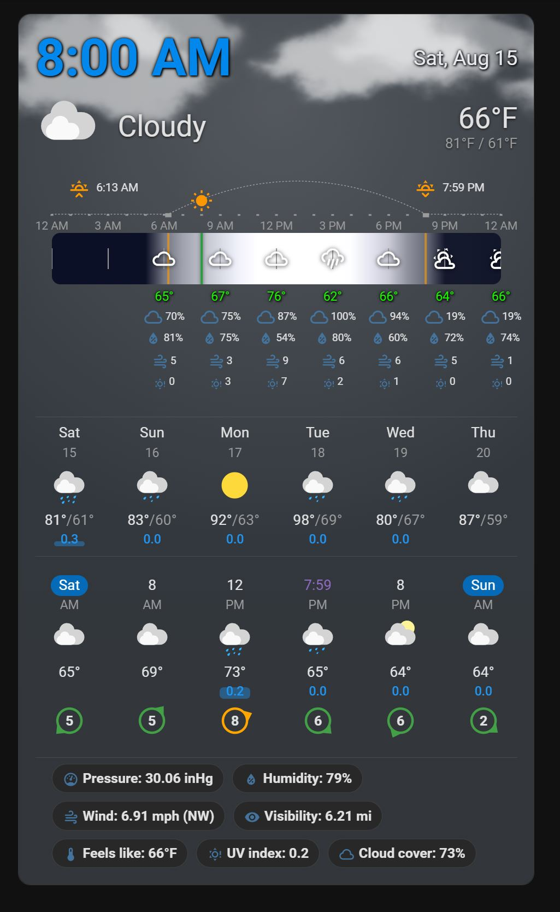
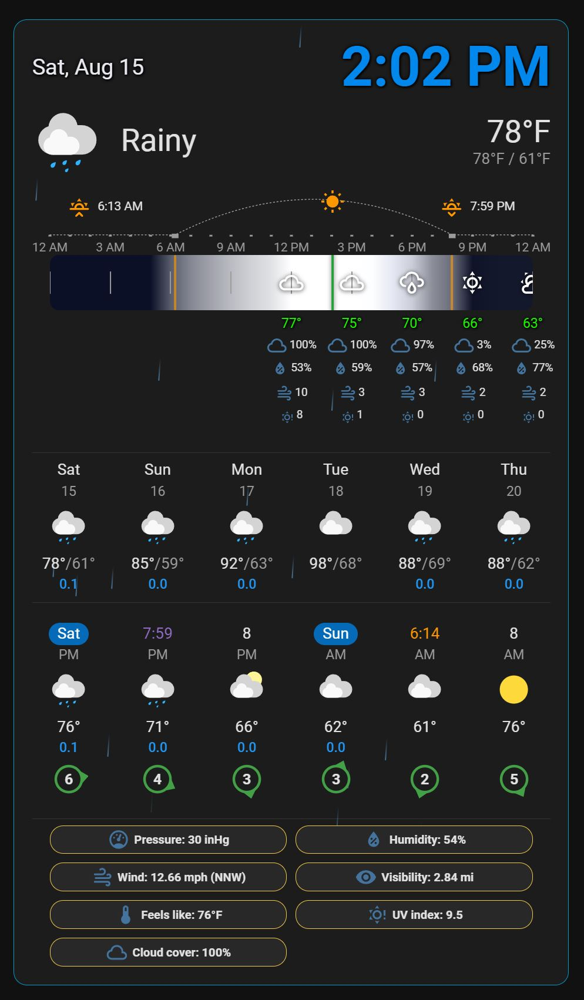
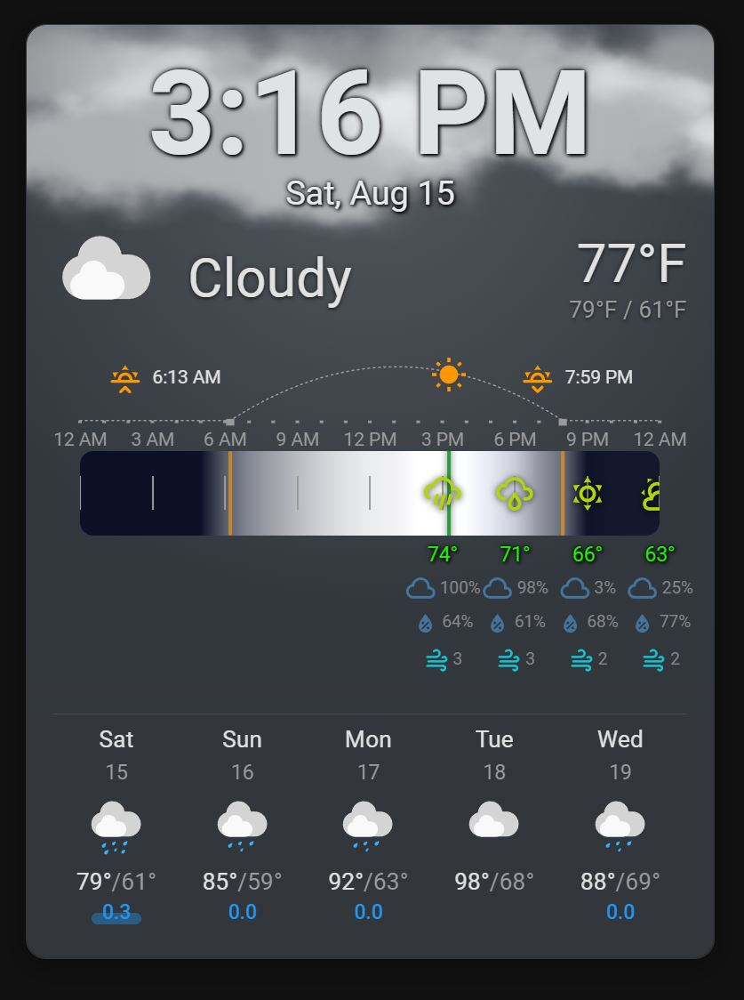
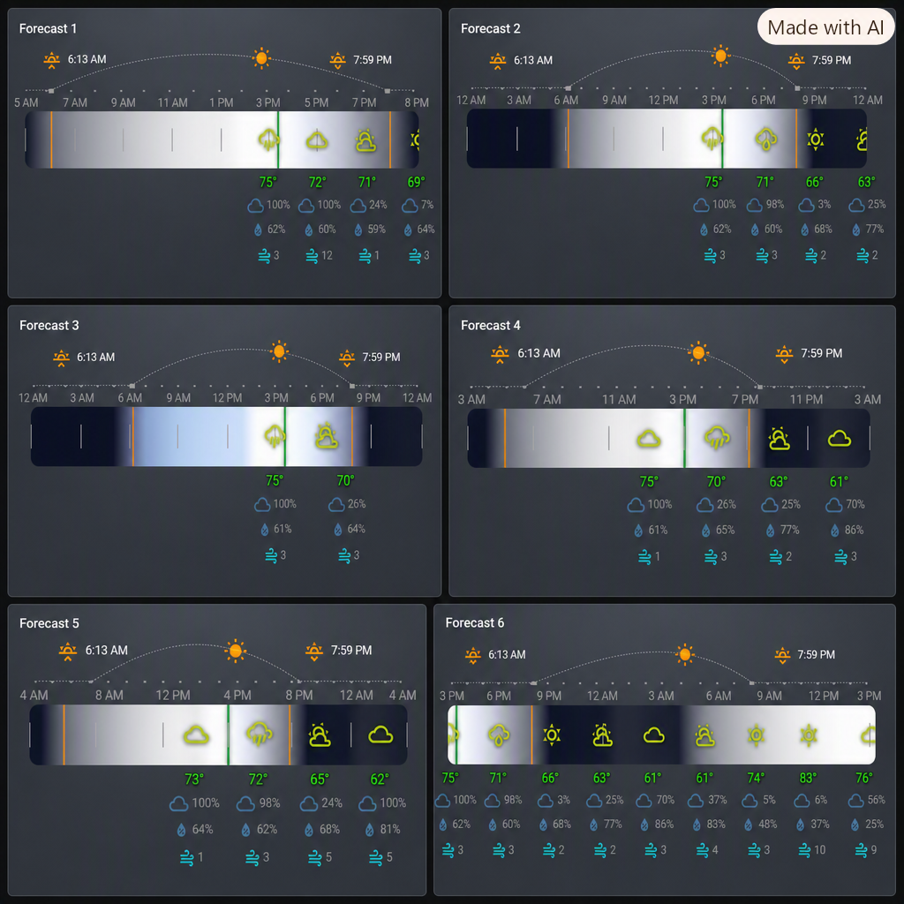
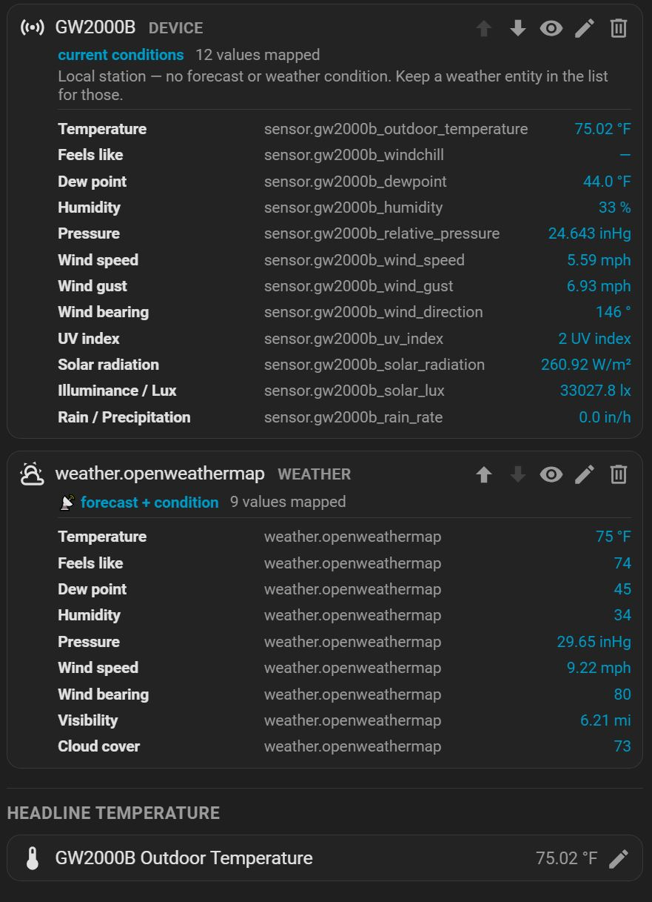

# Weather Flex Card

The Most Flexible and Feature Rich Weather Card available for Home Assistant.

A sectioned, fully-customizable weather card that lets you build exactly the weather display you want — current conditions, hourly/daily forecasts, a sky-brightness gradient bar, a sunrise/sunset arc, and a digital clock — each an independent, reorderable section with its own styling. Every section can pull from multiple weather entities and your own sensors.

... all in a super easy to use Visual Editor — no YAML required unless you prefer it.

https://github.com/Ltek/weather-flex-card

### ✨ Features

* **Sectioned, reorderable layout** – The card is built from independent sections — **Current Weather Header, Current Weather Metrics, Hourly Forecast, Daily Forecast, Sky Bar, Sun Position, and Clock & Date**. Drag to reorder, show/hide any section, and style each one on its own.
* **Multiple weather sources (ordered priority list)** – Build an **ordered list of sources** — top = highest priority. Each value is pulled from the first source in the list that has it, so order *is* precedence. A source can be a **weather entity**, a **local-station device** (e.g. Ecowitt — its sensors are auto-mapped to the right values), or any single **sensor**. Reorder with up/down arrows, **hide any source with the eye toggle** (kept in the list, skipped while hidden), and remove with the trash icon. Each row shows a **condensed Property · entity · value summary** of what it provides, plus an **edit (✎) view** for per-value overrides. The **forecast and weather condition** come from the highest weather entity in the list (tagged 📡). Forecasts merge across weather sources in the same priority order. Units are shown as each source reports them (no conversion).
* **Card Appearance** – Full card-wrapper styling to match any dashboard: border (per-side toggles + per-corner rounding), background color, glow, and a separate drop-shadow (color / X / Y / blur / spread / opacity). Custom weather-condition icon path and moon-phase shading included.
* **Current Weather Header** – Independent size controls for the condition icon, condition text, and temperature; a configurable sub-header metric (defaults to today's high/low), a custom friendly name, and a header metrics row drawn from built-in metrics and/or any entity.
* **Current Weather Metrics** – Display any set of weather metrics as a **Grid/Wrap list or as Chips**. Chips are fully styleable (text size, icon size, icon color, pill or custom corner radius, columns, show name/icon, hide-when-empty). Global value styling with per-value "Custom" overrides.
* **Hourly & Daily Forecasts** – Each type independently controls its **display mode** (Simple or Chart), **extra attribute**, **chart attribute**, and **number of slots** to show. Load only the forecast types you display to reduce websocket load on constrained devices.
* **Sky Bar** *(brightness & color gradient)* – A time-axis gradient showing day/night brightness and cloud cover. Configure the **timeframe** (fixed hours / full day / match the Sun Position arc), bar size and gradient colors, current-time marker, sunrise/sunset markers, and time labels + tick marks with adjustable **"show a label/tick every N hours"** spacing.
  * **Forecast Weather Metrics on the bar** – Overlay temps, condition icons, and extra attributes (wind, precipitation probability, UV, etc.) directly on the bar. Full ordering and per-side placement (above / on / below), with per-metric overrides for color, size, legibility, and **"Show every"** sampling — *every forecast hour, on tick marks, between tick marks, or every N hours*.
* **Sun Position arc** – A sunrise → solar-noon → sunset arc with a live sun marker, configurable window, tick marks, and sunrise/sunset time labels and icons.
* **Clock & Date** – An optional digital clock and date rendered in the header row. Independent placement, 12/24-hour format, seconds, popular date-format presets, per-element fonts/colors, and separate **text-legibility** (shadow/outline/auto) options for the time and the date.
* **Per-section styling** – Every section shares a consistent **Section Styles** panel: flush-to-edge/top/bottom, section dividers (above/below with thickness, length, style, color), and a semi-transparent section background — all with independent values per section.
* **Full visual editor** – Everything is configurable through the visual editor, organized into collapsible panels and sub-panels with per-section Reset buttons, modern sliders/dropdowns, and a read-only YAML view. Optional auto-collapse keeps the editor tidy.

### 🆕 What's New (build 2026.10.11.85 vs 2026.08.15.79)

The headline change is a completely reworked **Weather Sources** system, built to support local weather stations (Ecowitt, Tempest, Davis, …) that expose a *device with many sensors* instead of a single `weather.*` entity.

* **Local weather stations as a source.** Add a **device** (not just a weather entity) as a source. The card auto-maps its sensors to the right values — e.g. an Ecowitt GW2000B maps outdoor temperature, feels-like, dew point, humidity, pressure (sea-level, not absolute), wind speed/gust/direction, UV, solar radiation, lux, and rain — preferring outdoor over indoor and instantaneous over averaged readings.
* **Ordered priority list replaces Primary / Fallback / Custom.** Sources are now one ordered list — **top = highest priority** — and each value is pulled from the first source that has it. Order *is* precedence, so the old slot naming is gone. Soft cap of 4 sources.
* **"+ Add Source" button** at the top reveals the entity/device pickers only when pressed.
* **Per-source value mapping + overrides.** Every source shows a condensed **Property · entity · value** summary; an **edit (✎)** view lets you override any individual value to a different entity (your own sensor, a more accurate source, etc.).
* **Hide (eye) toggle per source** — temporarily disable a source without removing it or its mapping.
* **New values supported:** `temperature`, `wind_bearing`, and local-station extras **solar radiation, illuminance/lux, and rain/precipitation** (which have no standard weather-entity equivalent).
* **Forecast & weather condition** always come from the highest-priority weather entity in the list (tagged **📡**), with a clear warning if the list has no weather entity. Forecasts merge across weather sources in the same priority order.
* **Current-weather header fixes.** The header (headline temperature + built-in metrics) now honors every source in the list — previously it ignored the primary source and could not source the headline temperature at all, forcing use of the stock "Custom Temperature Entity" field. That field still works but is now an optional override; leaving it blank lets the source list drive the headline.
* **Editor polish.** All ordering selectors (sections, metrics, values, sources) share the standard reorder arrows and show/hide **eye** icons on the right, with theme-color representative icons on the left.
* **Fully backward compatible.** Existing cards keep working untouched; legacy configs are migrated to the new source list only when you next edit and save the Weather Sources panel.

See `CHANGELOG.md` for the per-build detail.

### 🚀 Installation

1. Create the folder `\config\www\community\weather-flex-card`
2. Download [`weather-flex-card.js`](https://github.com/Ltek/weather-flex-card/blob/main/weather-flex-card.js) and place it in that folder.
3. Add as a Dashboard Resource:

   * Go to Settings > Dashboards > three-dot menu > Add Resource
   * Enter `/local/community/weather-flex-card/weather-flex-card.js` and select "JavaScript Module"
   * Click "Add"
4. Clear your browser cache and refresh.

### 📸 Screenshots

Example showing just a fraction of the available options...

<!-- Add screenshot here -->

<!-- SCREENSHOTS:START -->
<table>
  <tr>
    <td align="center" valign="top">
      
    </td>
    <td align="center" valign="top">
      
    </td>
    <td align="center" valign="top">
      
    </td>
    <td align="center" valign="top">
      
    </td>
  </tr>
  <tr>
    <td align="center" valign="top">
      
    </td>
    <td></td>
    <td></td>
    <td></td>
  </tr>
</table>
<!-- SCREENSHOTS:END -->
